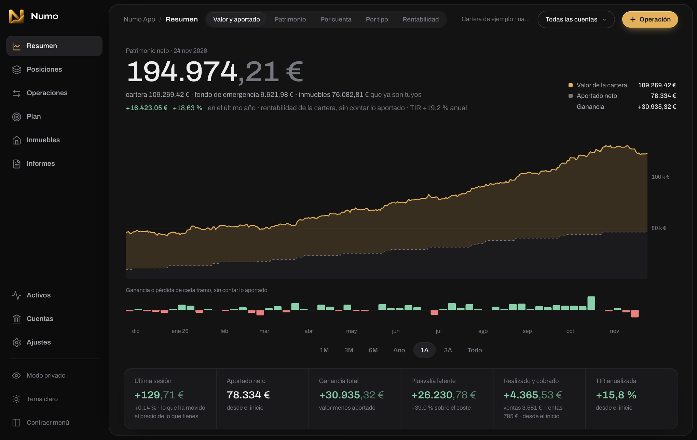
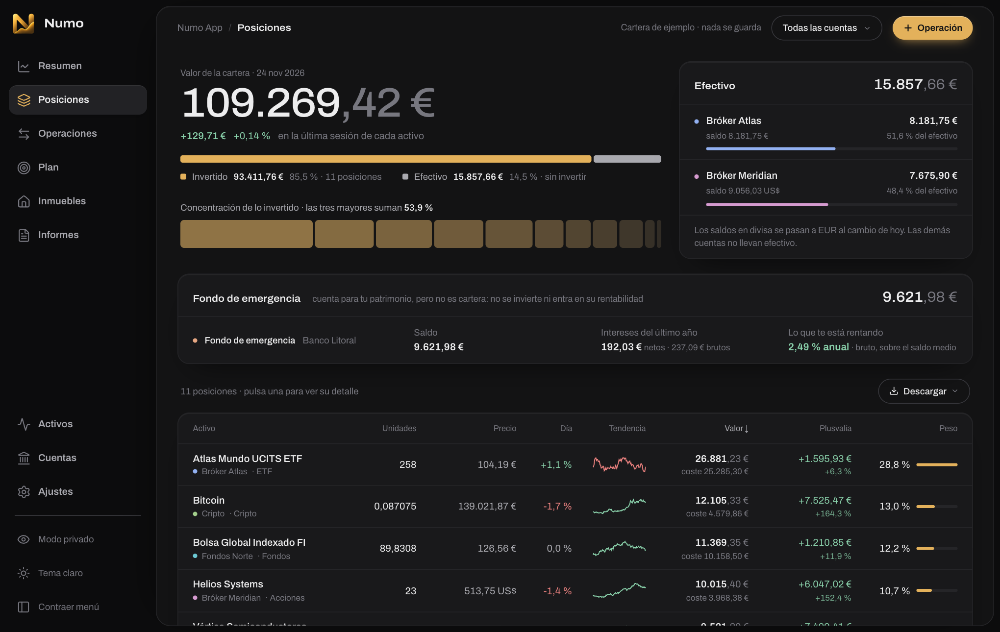
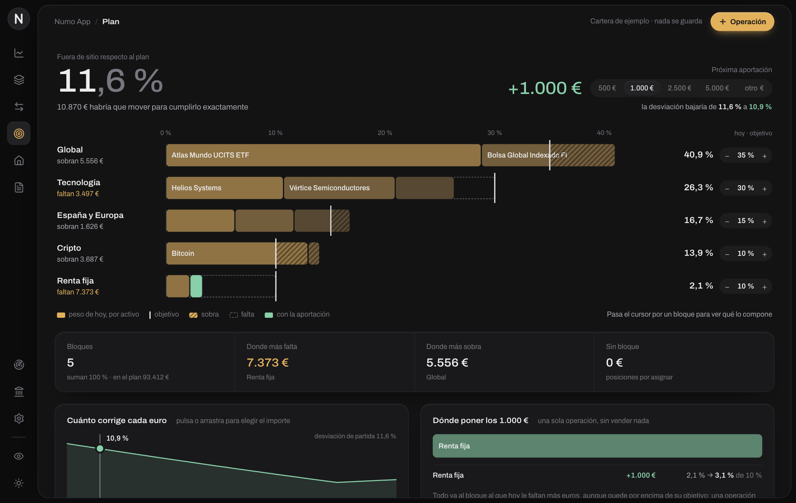
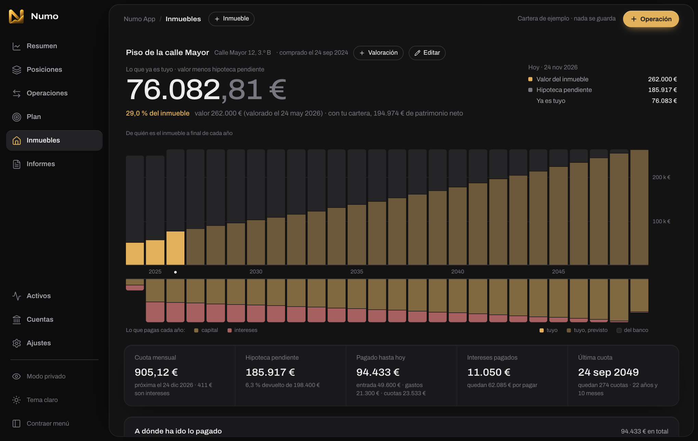
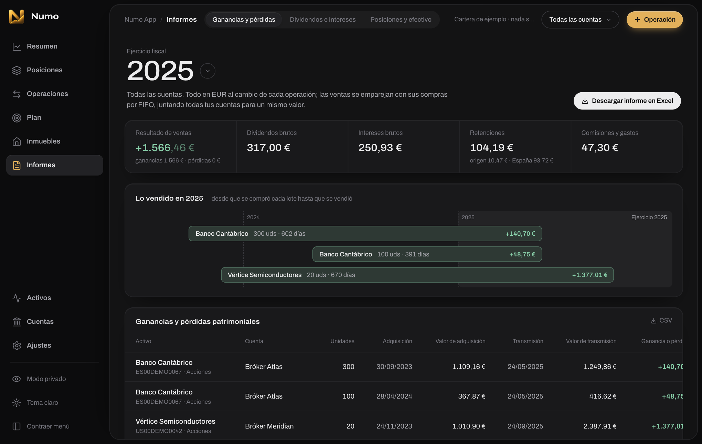
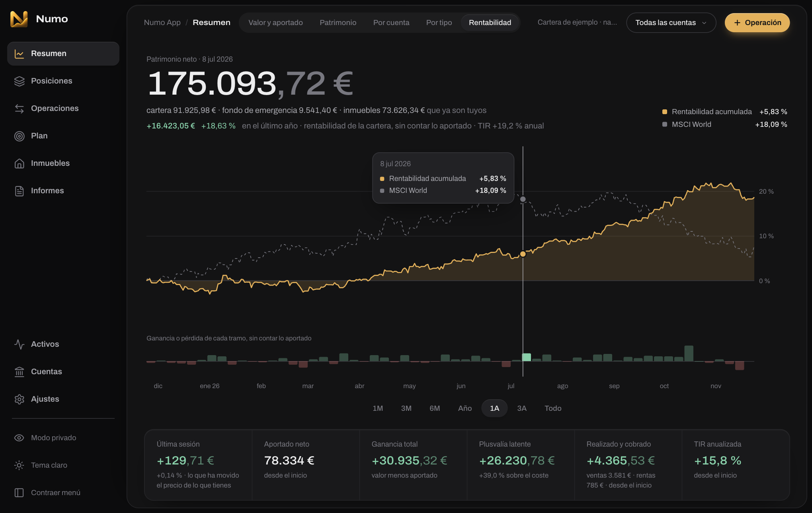
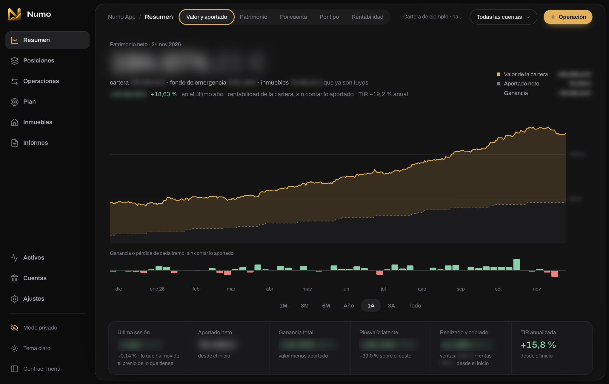

  

  <strong>Tu patrimonio, en tu ordenador.</strong> 
  Inversiones, efectivo e inmuebles en una app de escritorio para macOS y Windows. 
  Sin cuentas de usuario, sin servidores, sin suscripción.

  
  
  

  <a href="https://github.com/Nyhz/numo-desktop/releases/latest"><strong>Descargar la última versión</strong></a>

## Qué es

Numo App lleva la cuenta de lo que tienes y de cómo te va, con los datos guardados en un archivo de tu ordenador. Tú registras lo que haces (compras, ventas, dividendos, ingresos, tu vivienda y su hipoteca) y la app calcula el resto: posiciones, rentabilidad, plusvalías, reparto, cuadro de amortización y los extractos que pide Hacienda.

- **Todas tus cuentas juntas.** Brókers, bancos, fondos y exchanges, en varias divisas, con el efectivo de cada una.
- **Patrimonio neto de verdad.** La cartera, tu fondo de emergencia y lo que ya es tuyo de tus inmuebles, y cómo ha evolucionado.
- **Rentabilidad sin trampas.** Ponderada por tiempo y TIR anualizada, mes a mes, por posición y frente al MSCI World.
- **Precios al día sin pagar por ellos.** Acciones, ETF, fondos y criptomonedas se actualizan solos desde sus bolsas y gestoras; los tipos de cambio, del BCE.
- **Un plan de inversión.** Bloques con su peso objetivo, cuánto te alejas de él, dónde poner la próxima aportación y una proyección de a dónde llegarías.
- **Tu vivienda y su hipoteca.** Cuánto es ya tuyo, cuánto llevas pagado y en qué, y el cuadro año a año con revisiones del tipo.
- **Los papeles de Hacienda.** Ventas emparejadas por FIFO, dividendos e intereses con sus retenciones, posiciones a cierre de ejercicio y pérdidas pendientes de compensar; todo exportable a Excel y CSV.
- **Modo privado.** Un clic (o la tecla `P`) emborrona importes y unidades para enseñar la app sin enseñar cuánto hay.
- **En varios equipos.** Mac y Windows se sincronizan a través de una carpeta de tu nube, sin servidor de por medio y, si quieres, cifrada con tu contraseña.
- **Se actualiza sola.** Avisa cuando hay una versión nueva y la instala con un botón.

La app está en español y pensada para un inversor particular con residencia fiscal en España. La moneda de referencia es el euro.

## Capturas

| | |
|---|---|
|  |  |
|  |  |
|  |  |

Todas las capturas son de la cartera de ejemplo que trae la app (Ajustes → Cartera de ejemplo): entidades, empresas y cifras inventadas.

## Descargar e instalar

Los instaladores están en la [página de versiones](https://github.com/Nyhz/numo-desktop/releases/latest):

- **macOS** (Apple Silicon e Intel): descarga el `.dmg`, ábrelo y arrastra Numo App a Aplicaciones.
- **Windows** (64 bits): descarga el `-setup.exe` y ejecútalo.

No están firmados con certificados de pago, así que la primera vez el sistema avisa: en macOS, Ajustes del Sistema → Privacidad y seguridad → «Abrir igualmente»; en Windows, «Más información» → «Ejecutar de todas formas».

A partir de ahí **la app se actualiza sola**: al abrirla comprueba si hay una versión nueva y, si la hay, lo avisa arriba con un botón «Actualizar». También en Ajustes → Versión → «Buscar actualizaciones». Cada actualización va firmada y la app solo instala lo que lleva esa firma. Tus datos se conservan siempre.

¿Solo quieres mirar? Ajustes → «Ver la cartera de ejemplo» carga una cartera inventada sin tocar nada tuyo.

## Privacidad

- Tus datos están en un archivo SQLite en tu ordenador. No hay cuentas de usuario, ni servidor propio, ni telemetría.
- La app solo se conecta a las fuentes de precios (Deutsche Börse, BME, Nasdaq, fundinfo y Binance, con Yahoo Finance y Financial Times de respaldo), al BCE para los tipos de cambio, a GitHub para saber si hay una versión nueva y, si pones tu token, a Indexa Capital. A las fuentes de precios solo les envía símbolos y divisas, nunca importes ni posiciones.
- La app no puede conectarse a ningún otro sitio: la lista de servidores permitidos es fija.

## Pantallas

| Pantalla | Qué responde |
|---|---|
| Resumen | Tu patrimonio neto (la cartera, el fondo de emergencia y lo que ya es tuyo de los inmuebles), cuánto has puesto, cuánto ha ganado y cómo se reparte. |
| Posiciones | Qué tienes, cuánto pesa cada cosa y cuánto gana o pierde; se descarga en PDF (con gráficos), Excel o CSV. |
| Operaciones | El libro de operaciones y el flujo de efectivo; importar y exportar. |
| Plan | Cuánto te alejas de tu reparto objetivo, dónde poner la próxima aportación y a dónde llegarías con una aportación y una rentabilidad dadas. |
| Inmuebles | Cuánto es ya tuyo, cuánto llevas pagado y en qué, y cuánto queda. |
| Informes | Lo que pide Hacienda por ejercicio: ventas emparejadas, rendimientos, posiciones a cierre y pérdidas pendientes de compensar. |
| Activos | Todo lo que sigues, lo tengas o no en cartera: de qué día es cada precio, de dónde sale y qué no se está actualizando. Aquí se añaden activos nuevos. |
| Cuentas · Ajustes | Cuentas, copias de seguridad, conexiones con servicios de datos, actualización de la app, tema y color de acento. |

**Modo privado.** El ojo de la barra lateral (o la tecla `P`) emborrona importes, saldos y unidades en todas las pantallas, para enseñar la app sin enseñar cuánto hay; porcentajes, precios de mercado y fechas se siguen viendo. Se recuerda entre aperturas y no afecta a los datos ni a lo que se exporta.

Al abrir, una breve animación acompaña a la actualización de precios y termina con una onda que sale del logo y se convierte en la curva de tu cartera. Se salta con un clic y no se muestra si el sistema pide reducir el movimiento.

## Cómo calcula

Una idea manda sobre todo lo demás: **solo se guarda lo que tú registras** (cuentas, activos, operaciones, bloques del plan, inmuebles e hipotecas) y los datos de mercado descargados. Posiciones, lotes, plusvalías, rentabilidades, cuadros de amortización e informes se calculan al vuelo cada vez; no hay tablas derivadas que puedan desincronizarse.

- **Moneda de referencia: EUR.** Cada operación guarda su importe en su divisa y el tipo de cambio de ese día (por defecto, el de referencia del BCE; editable).
- **FIFO global por valor**, no por cuenta: las ventas consumen las compras más antiguas del mismo activo aunque estén en otra entidad.
- **Traspasos** entre fondos: no son una venta; el destino hereda fecha y coste de adquisición.
- **Splits**: las operaciones se registran tal como se ejecutaron; las unidades se ajustan solas.
- **Rentabilidad**: TWR (ponderada por tiempo) para el porcentaje y TIR anualizada (ponderada por dinero).
- **Precios**: cada activo tiene una fuente, todas gratuitas y sin cupo diario. Los cotizados se piden a su propia bolsa: Deutsche Börse (Xetra, por ISIN), BME (Madrid, por ISIN) y Nasdaq (EE. UU., por ticker); los fondos, a fundinfo (por ISIN); las criptomonedas, a Binance; el plan o la cartera de Indexa Capital, a su API con tu token de solo lectura. Si la fuente de un activo falla, se usa un respaldo (Yahoo Finance para cotizados, Financial Times para fondos) y queda anotado. También se puede elegir Yahoo, Financial Times o precio manual. Se actualizan al abrir la app (si han pasado más de 6 horas) para todos los activos dados de alta, con o sin posición. Al añadir un activo se comprueba que su fuente da precio; cada fallo queda anotado por activo y se ve en Activos. Cambiar un activo de fuente conserva su histórico.
- **Token de Indexa**: se pone en Ajustes → Conexiones. Se guarda en la base de datos local. Va dentro de las copias de seguridad.
- **Fondo de emergencia**: una cuenta de ese tipo cuenta para el patrimonio, pero queda fuera de la cartera y de su rentabilidad, porque es dinero que no se invierte. Posiciones enseña su saldo, los intereses del último año y lo que renta de verdad: intereses brutos entre saldo medio, anualizado, comparable con la TAE del banco. En Informes sí entra, porque sus intereses tributan.
- **Plan**: la aportación va entera al bloque más retrasado (al que hoy le faltan más euros), en una sola operación para ahorrar comisiones, aunque lo deje por encima de su objetivo. Nunca propone vender.
- **Hipoteca**: amortización francesa; el cuadro se deriva de las condiciones y de los eventos (revisión del tipo, cuota real).
- Numo App **no calcula impuestos**. El informe anual entrega los datos, avisa de pérdidas con recompra cercana y lleva una cuenta orientativa de las pérdidas pendientes de compensar, sin decidir nada.

## Varios equipos

Para usar Numo App en más de un ordenador (Mac y Windows, por ejemplo): Ajustes → Sincronización entre equipos → «Elegir carpeta…», y elegir **en cada equipo la misma carpeta** de un servicio de nube (Proton Drive, iCloud, OneDrive, Dropbox…). La app crea dentro una carpeta `numo-app`.

- La base de datos no se comparte: cada equipo tiene la suya. En la carpeta hay un archivo JSON por equipo con sus registros (cuentas, activos, operaciones, plan, inmuebles), cuándo cambió cada uno, cuáles se han borrado y el histórico de precios.
- Al sincronizar se leen los archivos de los demás y, registro a registro, **gana el cambio más reciente** (un borrado es un cambio más). Un equipo recién instalado nunca borra nada en los otros.
- Se sincroniza al abrir la app, al volver a su ventana, poco después de cada cambio y con «Sincronizar ahora». Lo rápido que llegue al otro equipo depende del servicio de nube.
- Antes de aplicar borrados o muchos cambios de golpe se guarda una copia en `copias/`.
- **Cifrado opcional.** En Ajustes → Sincronización entre equipos → Cifrado se pone una contraseña, la misma en cada equipo: desde entonces lo que llega a la nube es ilegible sin ella (clave derivada con Argon2id, contenido cifrado y autenticado con XChaCha20-Poly1305). La contraseña se guarda solo en cada equipo, nunca en la carpeta. Un equipo sin contraseña no publica nada mientras haya en la carpeta archivos cifrados de otro. Si se olvida no se pierde nada: se pone otra en todos y se vuelve a publicar.
- No viajan: las claves de Conexiones (se ponen en cada equipo), los tipos de cambio (cada equipo los descarga) ni los ajustes de apariencia.
- Conviene marcar la carpeta como «disponible sin conexión» en el servicio de nube, para que los archivos estén siempre en disco.

## Datos y copias

- Base de datos: `~/Library/Application Support/app.numo.desktop/numo.db` en macOS; `%APPDATA%\app.numo.desktop\numo.db` en Windows.
- Copia diaria automática (las 14 últimas) en la carpeta `copias/` de al lado.
- Ajustes → «Guardar una copia…» y «Exportar todas las operaciones» (un CSV legible). Una app recién instalada y vacía puede importar un CSV con ese formato desde su pantalla de bienvenida.

## Licencia

[MIT](LICENSE). Puedes usar, modificar y redistribuir el código; se entrega tal cual, sin garantía. Numo App no es asesoramiento financiero ni fiscal.
